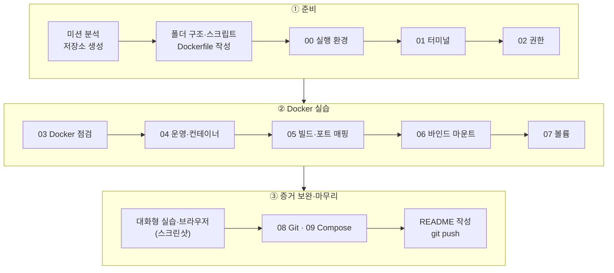
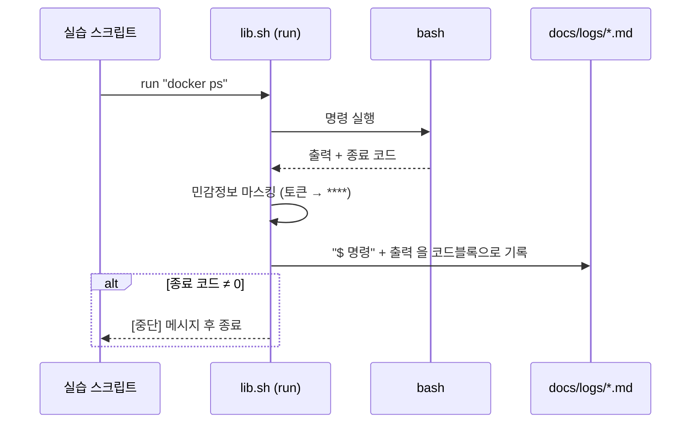
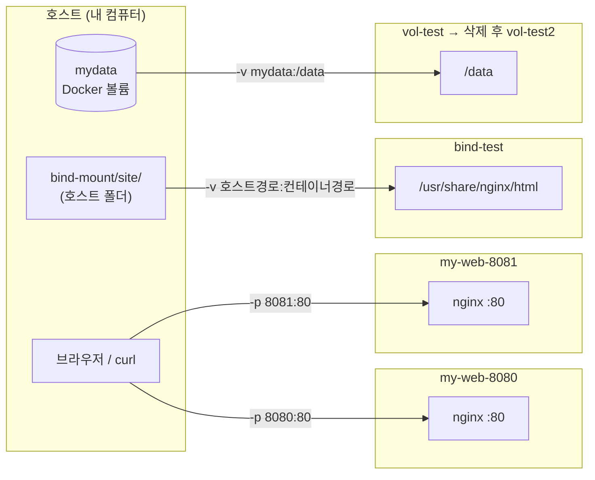

# 내 컴퓨터에 개발자용 '작업실' 꾸미기 🛠️

> 터미널(리눅스 CLI), Docker, Git/GitHub 를 직접 세팅하고,
> "실행 결과(로그·접속·데이터 유지)"로 검증해 누구나 같은 결과를 재현할 수 있는 개발 환경을 만든 미션

**💻 GitHub:** https://github.com/ilililililil4319/E1-1
**📋 미션:** E1-1 내 컴퓨터에 개발자용 '작업실' 꾸미기 (26년 경남 AI 올인원 1기 입학연수 · 개발 입문)
**🧾 실행 로그:** [`docs/logs/`](docs/logs/) (명령 + 출력 자동 기록)
**🖼 스크린샷:** [`docs/screenshots/`](docs/screenshots/)
**⚙️ 환경 세팅 가이드:** [`docs/SETUP.md`](docs/SETUP.md)


---

## 목차

1. [프로젝트 소개](#1-프로젝트-소개)
2. [핵심 질문 (스스로 설명할 6가지)](#2-핵심-질문-스스로-설명할-6가지)
3. [프로젝트 개요 및 산출물 구성](#3-프로젝트-개요-및-산출물-구성)
4. [폴더 구조](#4-폴더-구조)
5. [기술 스택 및 실행 환경](#5-기술-스택-및-실행-환경)
6. [사용 이미지 및 출처](#6-사용-이미지-및-출처)
7. [검증 방법 및 핵심 개념 요약](#7-검증-방법-및-핵심-개념-요약)
8. [전체 작업 순서 (STEP 1-14)](#8-전체-작업-순서-step-1-14)
9. [작업 흐름도](#9-작업-흐름도)
10. [Docker 연결 구조 (포트·마운트·볼륨)](#10-docker-연결-구조-포트마운트볼륨)
11. [핵심 실습 결과](#11-핵심-실습-결과)
12. [보너스 과제](#12-보너스-과제)
13. [로컬 실행 방법](#13-로컬-실행-방법)
14. [환경 변수 및 포트 설정](#14-환경-변수-및-포트-설정)
15. [실습 중 발생한 오류와 해결](#15-실습-중-발생한-오류와-해결)
16. [AI(Claude) 사용 로그 요약](#16-aiclaude-사용-로그-요약)
17. [기능요구사항 대비 결과](#17-기능요구사항-대비-결과)
18. [결론 및 한계점](#18-결론-및-한계점)
19. [보안 유의사항](#19-보안-유의사항)
20. [이미지·도구 출처 및 라이선스 유의사항](#20-이미지도구-출처-및-라이선스-유의사항)
21. [기타](#21-기타)

---

## 1. 프로젝트 소개

개발은 코드를 작성하는 순간이 아니라 환경을 세팅하는 순간부터 시작됩니다. 같은 코드가 "내 컴퓨터에서만" 돌아가는 문제를 줄이려면, 누가 어디서 실행해도 같은 결과가 나오는 환경이 필요합니다.

이 프로젝트는 터미널로 작업 폴더와 권한을 정리하고, Docker 로 컨테이너를 실행·관리하며, NGINX 기반 커스텀 이미지를 직접 만들어 포트 매핑·바인드 마운트·볼륨을 검증한 뒤, 모든 결과를 Git/GitHub 로 관리한 개인 미션입니다.

- **핵심 도구:** 리눅스 CLI(터미널) / Docker(컨테이너) / Git·GitHub(버전 관리·협업)
- **핵심 가치:** 따라 치는 실습이 아니라 "실행 결과"로 증명하고, README 만 보고도 같은 절차를 재현할 수 있게 문서화
- **자동화:** 실습 명령과 출력을 마크다운 로그로 자동 저장하는 스크립트(`scripts/`) 작성 → 재실행해도 같은 결과
- **보너스:** Docker Compose 멀티 컨테이너, 운영 명령(up/ps/logs/down), 환경 변수 주입

---

## 2. 핵심 질문 (스스로 설명할 6가지)

1. 절대 경로와 상대 경로는 무엇이 다른가?
2. 파일 권한 r/w/x 는 무슨 뜻이고, 755·644 는 어떤 규칙으로 읽는가?
3. 기존 이미지를 바탕으로 "커스텀 이미지"를 어떻게 만드는가?
4. 포트 매핑은 왜 필요한가?
5. Docker 볼륨(영속 데이터)은 무엇이고 바인드 마운트와 어떻게 다른가?
6. Git 과 GitHub 의 역할은 어떻게 다른가?

> 각 질문의 답은 [7장](#7-검증-방법-및-핵심-개념-요약)에, 직접 확인한 결과는 [11장](#11-핵심-실습-결과)에 정리했습니다.

---

## 3. 프로젝트 개요 및 산출물 구성

| # | 최종 결과물 (미션 요구) | 이 저장소의 위치 |
|:---:|---|---|
| 1 | 제출 저장소 | 본 저장소 (공개) |
| 2 | 기술 문서 | `README.md` (본 문서) |
| 3 | 터미널 조작 로그 | [`01_terminal.md`](docs/logs/01_terminal.md), [`02_permission.md`](docs/logs/02_permission.md) |
| 4 | Docker 운영/검증 로그 | [`03_docker_check.md`](docs/logs/03_docker_check.md), [`04_docker_ops.md`](docs/logs/04_docker_ops.md) |
| 5 | Dockerfile 기반 웹 서버 | [`app/Dockerfile`](app/Dockerfile), [`app/site/`](app/site/), [`05_build_run.md`](docs/logs/05_build_run.md) |
| 6 | 포트 매핑 접속 증거 | [11-6](#11-6-포트-매핑-접속) 스크린샷 2장 |
| 7 | 바인드 마운트 + 볼륨 증거 | [`06_bind_mount.md`](docs/logs/06_bind_mount.md), [`07_volume.md`](docs/logs/07_volume.md) |
| 8 | Git 설정 + GitHub/VSCode 연동 증거 | [`08_git.md`](docs/logs/08_git.md), [11-9](#11-9-git-설정-및-github-연동) 스크린샷 |

---

## 4. 폴더 구조

```text
E1-1/
├── README.md               # 기술 문서 (본 문서)
├── .gitignore              # 민감 파일·잡파일 제외
├── app/                    # 웹 서버 소스 + Dockerfile
│   ├── Dockerfile          #   nginx:1.27-alpine 기반 커스텀 이미지
│   └── site/index.html     #   교체한 정적 페이지
├── bind-mount/             # 바인드 마운트 실습 폴더 (site/ 는 스크립트가 생성)
├── compose/
│   └── docker-compose.yml  # 보너스: web + checker 멀티 컨테이너
├── scripts/                # 실습 자동화 (명령 + 출력 → docs/logs/*.md)
│   ├── lib.sh              #   공통 함수 (기록, 민감정보 마스킹, 실패 시 중단)
│   ├── 00_env.sh           #   실행 환경
│   ├── 01_terminal.sh      #   터미널 조작
│   ├── 02_permission.sh    #   권한
│   ├── 03_docker_check.sh  #   Docker 설치·점검
│   ├── 04_docker_ops.sh    #   운영 명령 + hello-world + ubuntu + exec
│   ├── 05_build_run.sh     #   커스텀 이미지 빌드 + 포트 매핑 2회
│   ├── 06_bind_mount.sh    #   바인드 마운트 반영
│   ├── 07_volume.sh        #   볼륨 영속성
│   ├── 08_git.sh           #   Git 설정 확인
│   ├── 09_compose.sh       #   보너스 Compose
│   └── run_all.sh          #   00~07 한 번에 실행
└── docs/
    ├── SETUP.md            # 환경 세팅 가이드 (Mac / Windows)
    ├── logs/               # 실행 로그
    └── screenshots/        # 스크린샷
```

---

## 용어 설명 (초보자를 위한 참고)

이 미션에서 사용한 CLI·Git·Docker 용어와 명령을 한 줄씩 정리했습니다.

### CLI (터미널)

| 용어 / 명령 | 뜻 |
| --- | --- |
| CLI | 글자로 명령을 입력해 컴퓨터를 다루는 방식 (Command Line Interface) |
| 쉘 (Shell) | 입력한 명령을 해석해 실행하는 프로그램 (bash, zsh) |
| 프롬프트 | 명령 입력을 기다리는 표시 (`$`, `root@...:/#`) |
| 루트 디렉토리 | 파일 시스템의 맨 꼭대기 `/` |
| 홈 디렉토리 | 사용자 개인 폴더 `~` |
| 절대 경로 | `/` 부터 시작하는 전체 경로 (`/home/codespace/codyssey`) |
| 상대 경로 | 현재 위치 기준 경로 (`./practice`, `../`) |
| `.` / `..` | 현재 디렉토리 / 상위 디렉토리 |
| 숨김 파일 | 이름이 `.` 으로 시작하는 파일 (`.gitignore`) |
| `pwd` | 현재 위치 출력 |
| `ls -la` | 숨김 파일 포함 상세 목록 (`-l` 상세, `-a` 전부) |
| `cd` | 디렉토리 이동 |
| `mkdir -p` | 디렉토리 생성 (`-p`: 중간 디렉토리까지 한 번에) |
| `touch` | 빈 파일 생성 |
| `cat` | 파일 내용 출력 |
| `cp` / `cp -r` | 파일 복사 / 디렉토리 통째로 복사 |
| `mv` | 이동 또는 이름 변경 |
| `rm` / `rm -r` | 파일 삭제 / 디렉토리 삭제 |
| `rmdir` | 빈 디렉토리 삭제 |
| `echo` | 문자열 출력 |
| `>` / `>>` | 출력을 파일에 덮어쓰기 / 이어쓰기 |
| `\|` (파이프) | 앞 명령의 출력을 뒤 명령의 입력으로 전달 (`docker info \| head -5`) |
| `curl` | 터미널에서 URL 요청 (`curl http://localhost:8080`) |

### 권한

| 용어 / 명령 | 뜻 |
| --- | --- |
| r / w / x | 읽기(4) / 쓰기(2) / 실행(1) |
| 소유자 / 그룹 / 기타 | 권한 3자리의 순서 (user / group / others) |
| 755 | `rwxr-xr-x` — 디렉토리, 실행 파일 |
| 644 | `rw-r--r--` — 일반 파일 |
| 700 | `rwx------` — 소유자만 접근 |
| 디렉토리의 x | 그 안으로 들어갈(`cd`) 수 있는 권한 |
| `ls -l` | 파일 권한 확인 (맨 앞 `-` 파일, `d` 디렉토리) |
| `ls -ld` | 디렉토리 자체의 권한 확인 |
| `chmod` | 권한 변경 (`chmod 755 파일`, `chmod u+x 파일`) |
| `sudo` | 관리자(root) 권한으로 명령 실행 |
| Permission denied | 권한이 없어서 거부됨 |

### Docker

| 용어 / 명령 | 뜻 |
| --- | --- |
| 컨테이너 | 이미지를 실행한 격리된 실행 환경 |
| 이미지 | 컨테이너를 만드는 읽기 전용 템플릿 |
| 레지스트리 / Docker Hub | 이미지를 저장·공유하는 저장소 |
| 태그 | 이미지 버전 이름 (`nginx:1.27-alpine` 의 `1.27-alpine`, 생략 시 `latest`) |
| 데몬 (엔진) | 컨테이너를 실제로 관리하는 백그라운드 프로그램 (`dockerd`) |
| 호스트 | Docker 가 설치되어 돌아가는 실제 컴퓨터 |
| 격리 | 컨테이너끼리, 그리고 호스트와 분리되어 서로 영향을 주지 않음 |
| 재현성 | 언제 어디서 실행해도 같은 결과가 나오는 성질 |
| `docker --version` | 설치 및 버전 확인 |
| `docker info` | 데몬 동작 여부 확인 |
| `docker pull` | 이미지 다운로드 |
| `docker images` | 이미지 목록 |
| `docker run` | 이미지로 컨테이너 생성 + 실행 |
| `docker ps` / `docker ps -a` | 실행 중인 컨테이너 / 종료된 것 포함 전체 |
| `docker stop` / `docker start` | 컨테이너 중지 / 다시 시작 |
| `docker rm` / `docker rm -f` | 컨테이너 삭제 / 실행 중이어도 강제 삭제 |
| `docker rmi` | 이미지 삭제 |
| `docker logs` | 컨테이너 출력 로그 확인 (`-f` 실시간) |
| `docker stats` | CPU·메모리 사용량 확인 (`--no-stream` 한 번만) |
| `docker exec -it 이름 bash` | 실행 중인 컨테이너에 새 bash 열기 (exit 해도 컨테이너 유지) |
| `docker attach` | 메인 프로세스에 연결 (exit 하면 컨테이너 종료) |
| `docker inspect` | 컨테이너/이미지 상세 정보 (JSON) |
| `-d` | 백그라운드 실행 (detached) |
| `-it` | 대화형 + 터미널 연결 (interactive + tty) |
| `--name` | 컨테이너 이름 지정 |
| `--rm` | 종료되면 자동 삭제 |
| `-e` | 환경 변수 전달 |
| `Ctrl+P, Ctrl+Q` | attach 상태에서 컨테이너를 끄지 않고 빠져나오기 |
| Exited (0) | 정상 종료된 컨테이너 상태 |
| OrbStack / Docker Desktop | sudo 없이(또는 GUI로) Docker 엔진을 실행해 주는 앱 |

### Dockerfile

| 용어 / 명령 | 뜻 |
| --- | --- |
| Dockerfile | 이미지를 만드는 명령을 적은 파일 |
| 베이스 이미지 | `FROM` 으로 지정하는 출발 이미지 |
| `FROM` | 베이스 이미지 지정 (첫 줄) |
| `RUN` | 빌드할 때 명령 실행 (패키지 설치 등) |
| `CMD` | 컨테이너 시작 시 기본 실행 명령 |
| `COPY` | 호스트 파일을 이미지 안으로 복사 |
| `WORKDIR` | 작업 디렉토리 지정 |
| `ENV` | 환경 변수 지정 |
| `LABEL` | 이미지 메타데이터(설명) |
| `EXPOSE` | 사용하는 포트를 문서로 표시 (실제 연결은 `-p`) |
| `HEALTHCHECK` | 컨테이너 상태 주기 검사 → `(healthy)` 표시 |
| `docker build -t 이름:태그 .` | 이미지 빌드 (`-t` 이름, `.` 빌드 컨텍스트) |
| 빌드 컨텍스트 | 빌드에 사용할 파일이 있는 폴더 (명령 끝의 `.`) |
| 커스텀 이미지 | 기존 베이스 이미지에 내 설정·파일을 더해 만든 이미지 |

### 포트 / 스토리지

| 용어 / 명령 | 뜻 |
| --- | --- |
| 포트 | 한 컴퓨터 안에서 프로그램을 구분하는 번호 (웹 80, 8080) |
| 포트 매핑 | 호스트 포트를 컨테이너 포트에 연결 |
| `-p 8080:80` | 호스트 8080 → 컨테이너 80 (순서: 호스트:컨테이너) |
| localhost | 내 컴퓨터 자신 (127.0.0.1) |
| port is already allocated | 호스트 포트가 이미 사용 중이라는 오류 |
| 바인드 마운트 | 호스트의 특정 폴더를 컨테이너에 연결 → 변경 즉시 반영 |
| `-v $(pwd)/site:/usr/share/nginx/html` | 바인드 마운트 (호스트 경로:컨테이너 경로) |
| 볼륨 | Docker 가 관리하는 저장 공간 → 컨테이너를 지워도 데이터 유지 |
| 영속성 | 컨테이너가 사라져도 데이터가 남는 성질 |
| `docker volume create` | 볼륨 생성 |
| `docker volume ls` / `inspect` / `rm` | 볼륨 목록 / 상세 / 삭제 |
| `-v mydata:/data` | 볼륨 연결 (볼륨 이름:컨테이너 경로) |

### Docker Compose

| 용어 / 명령 | 뜻 |
| --- | --- |
| Docker Compose | 여러 컨테이너 실행 설정을 YAML 파일 하나로 관리하는 도구 |
| `docker-compose.yml` | Compose 설정 파일 |
| 서비스 (services) | Compose 에서 실행할 컨테이너 단위 (`web`, `checker`) |
| 서비스 디스커버리 | 같은 Compose 네트워크에서 서비스 이름으로 접속 (`http://web/`) |
| `docker compose up -d` | 전체 서비스 실행 (`--build` 이미지 다시 빌드) |
| `docker compose ps` | 서비스 상태 |
| `docker compose logs` | 서비스 로그 |
| `docker compose down` | 전체 중지 + 컨테이너·네트워크 삭제 |

### Git / GitHub

| 용어 / 명령 | 뜻 |
| --- | --- |
| Git | 로컬에서 파일 변경 이력을 관리하는 버전 관리 도구 |
| GitHub | Git 저장소를 온라인에 올려 공유·협업하는 원격 플랫폼 |
| 저장소 (Repository) | 프로젝트 파일 + 변경 이력 |
| 로컬 / 원격 (remote) | 내 컴퓨터의 저장소 / GitHub 의 저장소 |
| origin | 원격 저장소의 기본 별칭 |
| 커밋 (commit) | 변경 내용을 저장한 기록(세이브 포인트) |
| 스테이징 영역 | 커밋할 파일을 모아 두는 곳 (`git add`) |
| 브랜치 (branch) | 독립된 작업 흐름, 기본 이름 `main` |
| `git config --global user.name / user.email` | 커밋 작성자 정보 설정 |
| `git config --global init.defaultBranch main` | 기본 브랜치 이름을 main 으로 |
| `git config --list` | 설정 전체 확인 |
| `git init` | 현재 폴더를 Git 저장소로 만들기 |
| `git clone` | 원격 저장소를 통째로 복사 |
| `git status` | 변경 상태 확인 |
| `git add .` | 변경 파일 전부 스테이징 |
| `git commit -m "메시지"` | 커밋 생성 |
| `git push` / `git pull` | 원격으로 올리기 / 원격에서 받아오기 |
| `git log --oneline` | 커밋 기록 한 줄씩 보기 |
| `git remote -v` | 연결된 원격 저장소 주소 확인 |
| `git reset HEAD~1` | 마지막 커밋 취소 (파일 변경은 유지) |
| `.gitignore` | Git 이 추적하지 않을 파일 목록 |
| HTTPS / SSH | GitHub 인증 방식: 로그인·토큰 / 키 쌍(공개키 등록) |
| 공개키 / 개인키 | GitHub 에 등록하는 키(`.pub`) / 절대 공유하지 않는 키 |
| 403 | 권한 없음 (push 거부) |
| Codespaces | GitHub 가 제공하는 브라우저 기반 클라우드 개발 환경 |

---

## 5. 기술 스택 및 실행 환경

| 구분 | 사용 기술 |
|---|---|
| CLI | bash, coreutils (`ls`, `cp`, `mv`, `chmod` …), `curl` |
| 컨테이너 | Docker Engine, Docker Compose, Dockerfile |
| 웹 서버 | NGINX (`nginx:1.27-alpine`) |
| 버전 관리 | Git, GitHub |
| 에디터 | VSCode (GitHub 계정 연동) |

교육장 PC(Windows)에 Docker 와 WSL 이 없어, 실습은 **GitHub Codespaces(클라우드 Ubuntu + Docker + 브라우저 VSCode)** 에서 수행했습니다. (경위: [15-1](#15-1-교육장-pc에서-docker-명령을-찾을-수-없음))

| 항목 | 값 | 근거 |
|---|---|:---:|
| 작업 환경 | GitHub Codespaces (교육장 Windows PC 의 브라우저로 접속) | — |
| OS | Ubuntu 24.04.5 LTS (x86_64) | [`00_env.md`](docs/logs/00_env.md) |
| Shell | GNU bash 5.2.21 | [`00_env.md`](docs/logs/00_env.md) |
| Terminal | VSCode 통합 터미널 (`TERM_PROGRAM=vscode`) | [`00_env.md`](docs/logs/00_env.md) |
| Docker | Docker version 29.9.2-2 (Server 29.9.2-2) | [`03_docker_check.md`](docs/logs/03_docker_check.md) |
| Git | git version 2.56.0 | [`00_env.md`](docs/logs/00_env.md) |

---

## 6. 사용 이미지 및 출처

| 이미지 | 용도 | 출처 |
|---|---|---|
| `hello-world` | Docker 설치·실행 확인 | Docker Hub 공식 이미지 |
| `ubuntu:24.04` | 컨테이너 진입, attach/exec 관찰, 볼륨 검증 | Docker Hub 공식 이미지 |
| `nginx:1.27-alpine` | 커스텀 이미지의 베이스, 바인드 마운트 실습 | Docker Hub 공식 이미지 |
| `alpine:3.20` | 보너스 Compose 의 보조 서비스(checker) | Docker Hub 공식 이미지 |
| `my-web:1.0` | **직접 만든 커스텀 이미지** (`app/Dockerfile`) | 본 저장소 |

- 태그를 `latest` 대신 버전으로 고정(`1.27-alpine`, `24.04`)해, 나중에 다시 실행해도 같은 버전이 내려오도록 했습니다 (재현성).

---

## 7. 검증 방법 및 핵심 개념 요약

**검증 원칙:** 모든 실습은 `scripts/` 의 스크립트로 실행하고, 스크립트가 "입력 명령 + 출력 결과"를 코드블록으로 `docs/logs/*.md` 에 자동 저장합니다. 명령이 실패하면 즉시 멈추므로, 로그가 끝까지 있다는 것 자체가 성공의 증거입니다. 대화형(`-it`) 실습과 브라우저 접속은 스크린샷으로 남겼습니다.

| 핵심 질문 | 한 줄 답 | 확인한 결과 |
|---|---|---|
| 절대 vs 상대 경로 | 절대 경로는 `/` 부터 시작해 어디서나 같은 곳, 상대 경로는 현재 위치 기준(`./`, `../`) | `cd ..` → `cd ./practice` 후 `pwd` 비교 |
| r/w/x, 755·644 | r=4, w=2, x=1 을 더해 소유자/그룹/기타 순서로 표기. 755=`rwxr-xr-x`, 644=`rw-r--r--` | 폴더 x 를 빼자 `cd` 시 `Permission denied` |
| 커스텀 이미지 | 베이스 이미지(`FROM`) 위에 내 파일·설정(`COPY`, `ENV`, `LABEL`, `HEALTHCHECK`)을 더해 빌드 | `my-web:1.0` 빌드, `healthy`, `APP_ENV=dev` |
| 포트 매핑 | 컨테이너는 격리된 네트워크라 밖에서 직접 못 들어감 → `-p 호스트:컨테이너` 로 연결 | 같은 이미지로 8080, 8081 두 번 접속 |
| 볼륨 | Docker 가 관리하는 저장소. 컨테이너를 지워도 데이터 유지(영속성). 바인드 마운트는 내 폴더를 연결해 변경 즉시 반영 | 컨테이너 삭제 후 새 컨테이너에서 `hi` 확인 |
| Git vs GitHub | Git 은 로컬 버전 관리 도구, GitHub 는 원격 저장소·협업 플랫폼 | 로컬 커밋 → `git push` 로 GitHub 반영 |

---

## 8. 전체 작업 순서 (STEP 1-14)

| STEP | 작업 내용 | 증빙 |
|:---:|---|:---:|
| 1 | 미션 분석, GitHub 저장소 생성 | — |
| 2 | 폴더 구조·자동화 스크립트·Dockerfile·`.gitignore` 구성 | [4장](#4-폴더-구조) |
| 3 | 실행 환경 준비 (교육장 PC 에 Docker 없음 → Codespaces 전환) | [15-1](#15-1-교육장-pc에서-docker-명령을-찾을-수-없음) |
| 4 | 실행 환경 기록 | `00_env.md` |
| 5 | 터미널 기본 조작 (위치·목록·이동·생성·복사·이름변경·삭제) | `01_terminal.md` |
| 6 | 권한 실습 (파일 644→755, 디렉토리 755→700, x 제거 실험) | `02_permission.md` |
| 7 | Docker 설치·점검 (`--version`, `info`) | `03_docker_check.md` |
| 8 | Docker 운영 명령 + hello-world + ubuntu 진입 + attach/exec 관찰 | `04_docker_ops.md`, 스크린샷 3장 |
| 9 | Dockerfile 커스텀 이미지 빌드 | `05_build_run.md` |
| 10 | 포트 매핑 2회 실행 + 브라우저 접속 | `05_build_run.md`, 스크린샷 2장 |
| 11 | 바인드 마운트 변경 반영 검증 | `06_bind_mount.md` |
| 12 | 볼륨 영속성 검증 | `07_volume.md` |
| 13 | Git 설정 + VSCode GitHub 연동 + 보너스 Compose | `08_git.md`, `09_compose.md`, 스크린샷 1장 |
| 14 | README 작성, 민감정보 마스킹, 최종 제출 | 본 문서 |

---

## 9. 작업 흐름도

**목적:** 이 미션은 "환경 준비 → 실습 → 증거 수집 → 문서화"가 반복되는 구조다. 어떤 단계에서 어떤 증거가 만들어지는지 한눈에 보이도록 정리했다.

### 9-1. 전체 진행 흐름

**설명:** ①·② 의 스크립트 실행(C~J)이 로그를 자동으로 만들고, 대화형 실습과 브라우저 접속(K)은 스크린샷으로 보완한 뒤, 모두 GitHub 에 커밋한다.



### 9-2. 스크립트 한 줄이 로그가 되는 과정

**설명:** `run "명령"` 한 줄이 실행되면 화면 출력과 로그 기록이 동시에 일어나고, 실패하면 그 자리에서 멈춘다.



---

## 10. Docker 연결 구조 (포트·마운트·볼륨)

**설명:** 컨테이너는 호스트와 격리되어 있어서, 바깥과 연결하려면 네트워크는 **포트 매핑**, 파일은 **바인드 마운트** 또는 **볼륨**이라는 "문"을 직접 만들어야 한다.



### 설계 노트

- **같은 이미지, 다른 호스트 포트:** 컨테이너 안의 포트(80)는 서로 격리되어 같아도 되지만, 호스트 포트는 겹치면 `port is already allocated` 오류가 난다. 그래서 8080, 8081 로 나눴다.
- **`EXPOSE` 와 `-p` 는 다르다:** `EXPOSE 80` 은 "이 이미지는 80번을 쓴다"는 문서일 뿐이고, 실제 연결은 `docker run -p` 가 한다.
- **바인드 마운트는 개발용, 볼륨은 데이터용:** 바인드 마운트는 호스트에서 파일을 고치면 재빌드 없이 바로 반영된다. 볼륨은 컨테이너를 지워도 남아 DB 같은 데이터 보관에 쓴다.
- **`-p` 와 `-v` 모두 "밖:안" 순서:** 왼쪽이 호스트(또는 볼륨 이름), 오른쪽이 컨테이너다.

---

## 11. 핵심 실습 결과

### 11-1. 터미널 조작

`pwd`, `ls -la`(숨김 포함), `cd`(절대/상대), `mkdir -p`, `touch`, `echo >`/`>>`, `cat`, `cp`, `mv`, `rm`, `rmdir` 을 순서대로 수행했습니다. → [`01_terminal.md`](docs/logs/01_terminal.md)

### 11-2. 권한 변경 (파일 1, 디렉토리 1)

```bash
$ ls -l perm_file.txt          # 변경 전 644
-rw-r--r-- 1 codespace codespace 16 Nov  4 07:53 perm_file.txt
$ chmod 755 perm_file.txt
$ ls -l perm_file.txt          # 변경 후 755
-rwxr-xr-x 1 codespace codespace 16 Nov  4 07:53 perm_file.txt

$ ls -ld perm_dir              # 변경 전 755
drwxr-xr-x 2 codespace codespace 4096 Nov  4 07:53 perm_dir
$ chmod 700 perm_dir
$ ls -ld perm_dir              # 변경 후 700
drwx------ 2 codespace codespace 4096 Nov  4 07:53 perm_dir
```

디렉토리에서 x 를 빼면(`chmod 600`) `cd: perm_dir: Permission denied` 가 나는 것도 확인했습니다. → [`02_permission.md`](docs/logs/02_permission.md)

### 11-3. Docker 설치·점검 및 운영 명령

- `docker --version` → 설치 확인, `docker info` → 데몬(Server) 동작 확인 → [`03_docker_check.md`](docs/logs/03_docker_check.md)
- `pull`, `images`, `run`, `ps`, `ps -a`, `logs`, `stats --no-stream`, `stop`, `start`, `rm` → [`04_docker_ops.md`](docs/logs/04_docker_ops.md)
- `hello-world` 는 메시지를 출력하고 할 일이 끝나 종료되므로 `docker ps` 에는 없고 `docker ps -a` 에만 `Exited (0)` 으로 보입니다.

### 11-4. ubuntu 컨테이너 진입 및 attach / exec 비교

```bash
docker run -it --name my-ubuntu ubuntu:24.04 bash   # 프롬프트가 root@...:/# 로 바뀜
ls
echo "hello from inside"
exit
```


```bash
docker start my-ubuntu
docker exec -it my-ubuntu bash    # 새 bash 를 하나 더 열기
exit
docker ps                         # → Up (계속 실행)
docker attach my-ubuntu           # 메인 bash 에 직접 붙기
exit
docker ps -a                      # → Exited (0)
```


| 방법 | 동작 | exit 후 컨테이너 |
|---|---|:---:|
| `docker exec -it` | 컨테이너 안에 **새 프로세스**를 추가로 실행 | Up |
| `docker attach` | 이미 돌고 있는 **메인 프로세스(PID 1)** 에 연결 | Exited |

컨테이너는 메인 프로세스가 살아 있는 동안만 실행됩니다. attach 상태에서 끄지 않고 나오려면 `Ctrl+P` → `Ctrl+Q`.

### 11-5. Dockerfile 커스텀 이미지 (방식 A: 웹 서버 베이스 + 정적 콘텐츠 교체)

- **베이스:** `nginx:1.27-alpine` — 웹 서버가 이미 들어 있고 가벼우며, 버전을 고정해 재현성 확보
- **Dockerfile:** [`app/Dockerfile`](app/Dockerfile)

| 커스텀 포인트 | 목적 | 확인 방법 · 결과 |
|---|---|---|
| `COPY site/ /usr/share/nginx/html/` | 기본 환영 페이지를 내 페이지로 교체 | `curl` → "Hello from my custom NGINX image (E1-1)" |
| `ENV APP_ENV=dev` | 실행 모드 설정값 주입 | `docker exec my-web-8080 printenv APP_ENV` → `dev` |
| `LABEL ...` | 이미지 설명 메타데이터 | `docker inspect` → title/description 표시 |
| `HEALTHCHECK` | 10초마다 응답 검사 | `.State.Health.Status` → `healthy` |

```bash
$ docker build -t my-web:1.0 .
$ docker images my-web
IMAGE        ID             DISK USAGE   CONTENT SIZE
my-web:1.0   bece07595fb3       73.6MB           21MB
```

→ [`05_build_run.md`](docs/logs/05_build_run.md)

### 11-6. 포트 매핑 접속

```bash
$ docker run -d -p 8080:80 --name my-web-8080 my-web:1.0
$ docker run -d -p 8081:80 --name my-web-8081 my-web:1.0
$ docker ps --filter name=my-web
... 0.0.0.0:8081->80/tcp ...   my-web-8081
... 0.0.0.0:8080->80/tcp ...   my-web-8080
```

Codespaces 는 호스트 포트를 `https://<코드스페이스>-<포트>.app.github.dev` 주소로 전달합니다. 주소창의 `-8080`, `-8081` 이 호스트 포트이며, 같은 응답을 `curl http://localhost:8080` 으로도 확인했습니다.


### 11-7. 바인드 마운트 (변경 반영)

```bash
$ docker run -d -p 8082:80 --name bind-test -v "$(pwd)/site":/usr/share/nginx/html nginx:1.27-alpine
$ curl -s http://localhost:8082
<h1>Before: bind mount test</h1>
$ echo '<h1>After: changed on host!</h1>' > site/index.html     # 호스트에서만 수정
$ curl -s http://localhost:8082
<h1>After: changed on host!</h1>                                  # 재빌드 없이 즉시 반영
```

→ [`06_bind_mount.md`](docs/logs/06_bind_mount.md)

### 11-8. 볼륨 (영속성)

```bash
$ docker volume create mydata
$ docker run -d --name vol-test -v mydata:/data ubuntu:24.04 sleep infinity
$ docker exec vol-test bash -lc 'echo hi > /data/hello.txt && cat /data/hello.txt'
hi
$ docker rm -f vol-test                                            # 컨테이너 삭제
$ docker run -d --name vol-test2 -v mydata:/data ubuntu:24.04 sleep infinity
$ docker exec vol-test2 bash -lc 'cat /data/hello.txt'
hi                                                                 # 데이터 유지
```

→ [`07_volume.md`](docs/logs/07_volume.md)

### 11-9. Git 설정 및 GitHub 연동

- `git config --global user.name / user.email / init.defaultBranch main` 설정 후 `git config --list` 기록 → [`08_git.md`](docs/logs/08_git.md)
- VSCode(Codespaces)에 GitHub 계정으로 로그인했고, 이 저장소의 커밋·push 를 이 연동으로 수행했습니다.


---

## 12. 보너스 과제

설정: [`compose/docker-compose.yml`](compose/docker-compose.yml) · 실행: [`scripts/09_compose.sh`](scripts/09_compose.sh) · 로그: [`09_compose.md`](docs/logs/09_compose.md)

| # | 과제 | 수행 내용 | 확인 결과 | 달성 |
|:---:|---|---|---|:---:|
| 1 | Compose 기초 | `docker run` 옵션(이미지·포트·환경 변수)을 `docker-compose.yml` 로 문서화 | `docker compose up -d --build` 로 web 서비스 빌드·실행 | ✅ |
| 2 | 멀티 컨테이너 | `web`(내 nginx) + `checker`(alpine) | checker 가 `http://web/` 으로 접속해 내 페이지 수신 → 컨테이너 간 통신 성공 | ✅ |
| 3 | 운영 명령어 | `up` → `ps` → `logs` → `down` → `ps` | 두 서비스 Up, web `(healthy)` / down 후 목록 비어 있음 | ✅ |
| 4 | 환경 변수 | `APP_ENV=dev WEB_PORT=8090 docker compose up -d` | `printenv APP_ENV` → `dev`, `localhost:8090` 응답 | ✅ |
| 5 | GitHub SSH 키 | — | 이번에는 HTTPS 방식으로 push (미수행) | ⬜ |

**배운 점:** 실행 명령을 파일로 문서화하면 누구나 `up` 한 줄로 같은 구성을 재현할 수 있고, 포트·모드 같은 설정은 환경 변수로 분리해 코드를 고치지 않고 바꿀 수 있다.

---

## 13. 로컬 실행 방법

자세한 설치 방법은 [`docs/SETUP.md`](docs/SETUP.md) 를 참고하세요.

- **Windows (WSL2 + Docker Desktop) 단계별 가이드 W1~W12:** [바로 가기](docs/SETUP.md#windows-wsl2--docker-desktop--처음부터-순서대로)

### 내 PC (Docker 설치 + 실행된 상태)

```bash
git clone https://github.com/ilililililil4319/E1-1.git
cd E1-1
bash scripts/run_all.sh        # 00~07 실행 → docs/logs/ 에 저장
bash scripts/08_git.sh         # Git 설정 확인
bash scripts/09_compose.sh     # (보너스)
```

### 설치 없이 GitHub Codespaces

1. 저장소 페이지 → `<> Code` → `Codespaces` → `Create codespace on main`
2. 브라우저에 VSCode 가 열리면 터미널에서 위와 같은 `bash scripts/...` 실행
3. 웹 접속은 `포트` 탭의 전달된 주소(`...-8080.app.github.dev`)로 확인

> 대화형 실습([11-4](#11-4-ubuntu-컨테이너-진입-및-attach--exec-비교))은 명령을 **한 줄씩** 직접 입력합니다.

---

## 14. 환경 변수 및 포트 설정

| 이름 | 위치 | 기본값 | 역할 |
|---|---|---|---|
| `APP_ENV` | `app/Dockerfile` (`ENV`) | `dev` | 실행 모드 표시 |
| `APP_ENV` | `compose/docker-compose.yml` | `prod` (실행 시 `dev` 주입) | Compose 에서 모드 변경 |
| `WEB_PORT` | `compose/docker-compose.yml` | `8090` | Compose web 서비스의 호스트 포트 |

| 호스트 포트 | 용도 |
|:---:|---|
| 8080, 8081 | 커스텀 이미지 포트 매핑 2회 |
| 8082 | 바인드 마운트 실습 |
| 8090 | 보너스 Compose |

이미 사용 중인 포트가 있으면 스크립트의 숫자 또는 `WEB_PORT` 를 바꿔 실행합니다.

---

## 15. 실습 중 발생한 오류와 해결

(문제 → 원인 가설 → 확인 → 해결/대안)

### 15-1. 교육장 PC에서 docker 명령을 찾을 수 없음

- **문제:** 경남대 교육장에서 작업하다가 봉암동 교육장으로 옮겨 작업했다. 봉암동 교육장 PC 의 PowerShell 에서 `docker run ...` 을 실행하자 `'docker' 용어가 cmdlet, 함수, 스크립트 파일 또는 실행할 수 있는 프로그램 이름으로 인식되지 않습니다 (CommandNotFoundException)` 오류가 났다.
- **원인 가설:** 이 PC(Windows)에 Docker 가 설치되어 있지 않거나, 리눅스 환경(WSL)이 없다.
- **확인:** `PS C:\Users\...` 프롬프트 → Windows PowerShell / `docker --version` → 같은 오류(미설치) / `wsl -l -v` → `Linux용 Windows 하위 시스템 설치되어 있지 않습니다`
- **해결/대안:**
  - 선택: **GitHub Codespaces** 로 전환. 설치 없이 Ubuntu + Docker + VSCode 를 바로 쓸 수 있고, `chmod` 권한 실습도 진짜 리눅스에서 동작한다.
  - 다른 대안: Docker Desktop(+ WSL2) 설치. 관리자 권한·재부팅이 필요할 수 있어 공용 PC 에서는 운영진 허가가 필요하다. Windows 폴더(NTFS)에서는 `chmod` 가 반영되지 않아 권한 실습은 WSL·컨테이너 안에서 해야 한다.
  - 공용 PC 에 WSL 설치 안내가 떴을 때는 `ESC` 로 취소했다.

### 15-2. 대화형 컨테이너에 여러 줄을 붙여 넣었더니 명령이 실행되지 않음

- **문제:** `docker run -it ... bash` 와 `ls`, `echo`, `exit` 를 한꺼번에 붙여 넣었더니 프롬프트만 `root@0defc4e8da2c:/#` 로 바뀌고 `ls`, `echo` 결과가 나오지 않았다.
- **원인 가설:** 컨테이너 bash 가 준비되기 **전에** 나머지 줄이 입력되어 컨테이너로 전달되지 않았다.
- **확인:** 컨테이너 프롬프트에서 `ls` 를 한 줄씩 다시 입력하자 `bin boot dev etc ...` 가 정상 출력됐다.
- **해결/대안:** 대화형 컨테이너에서는 프롬프트가 바뀐 것을 확인한 뒤 **한 줄씩** 입력한다. 여러 명령을 한 번에 실행하려면 `docker run --rm ubuntu:24.04 bash -c 'ls && echo hi'` 처럼 비대화형으로 쓴다.

### 15-3. 공용 PC 폴더에서 push 하자 403 거부 (다른 사람 저장소·계정)

- **문제:** 교육장 PC 바탕화면 폴더에서 커밋 후 `git push` 하자 `remote: Permission to vlfgl/M1-1.git denied to love4xox.` / `error: 403`. 그래서 Codespaces 에는 `README.md` 만 있었다.
- **원인 가설:** 그 폴더가 이전 사용자의 저장소에 연결되어 있고, PC 에 다른 사람의 GitHub 로그인이 남아 있다.
- **확인:** 오류 메시지에 내 저장소가 아닌 `vlfgl/M1-1` 과 다른 계정(`love4xox`)이 표시됨.
- **해결/대안:** 그 폴더의 커밋은 `git reset HEAD~1` 로 되돌리고 사용을 중단했다. 내 계정으로 연결된 Codespaces 에 파일을 올려 커밋·push 했다. 공용 PC 에서는 `git remote -v` 로 연결된 저장소부터 확인하고, 작업 후 로그아웃한다.

### 15-4. 스크린샷 파일 이름이 `port-8080.png.png` 로 저장됨

- **문제:** README 에서 `port-8080.png` 이미지가 보이지 않았다.
- **원인 가설:** 저장할 때 이름에 `.png` 를 직접 써서 확장자가 두 번 붙었다.
- **확인:** 탐색기에 `port-8080.png.png` 로 표시됨.
- **해결/대안:** `mv docs/screenshots/port-8080.png.png docs/screenshots/port-8080.png`

---

## 16. AI(Claude) 사용 로그 요약

| 사용 작업 | 사용 이유 | 검증 방법 |
|---|---|---|
| 미션 분석, 폴더 구조와<br/>실습 자동화 스크립트 초안 | 반복 명령과 출력을<br/>빠짐없이 기록하기 위해 | 직접 실행해 `docs/logs/` 의<br/>명령·출력을 하나씩 확인 |
| Dockerfile 커스텀 포인트 설계 | 베이스 이미지 선택과<br/>커스텀 목적 정리 | 빌드 성공, `healthy`,<br/>`printenv`, `inspect` 로 확인 |
| 교육장 PC 환경 문제 분석<br/>(Docker·WSL 없음, push 403) | 오류 메시지 원인 분석과<br/>대안(Codespaces) 비교 | 직접 명령(`docker --version`,<br/>`wsl -l -v`, `git remote -v`)으로 확인 |
| README 구성, 용어 정리,<br/>스크린샷 아이디 마스킹 | 문서 구조화와<br/>개인정보 보호 | GitHub 에서 링크·이미지 표시 확인 |
| 개념 학습 노트·예상 문제 | 비전공자로서 개념 이해 | 핵심 질문 6가지를 직접 말로 설명 |

> 모든 명령은 직접 실행했고, 로그와 스크린샷은 내 실행 결과입니다. AI 가 제안한 내용은 실제 출력으로 다시 확인한 뒤에만 반영했습니다.

---

## 17. 기능요구사항 대비 결과

| 요구사항 | 구현 위치 | 달성 |
|---|---|:---:|
| 제출 저장소 + 기술 문서<br/>(개요·환경·체크리스트·검증·증거 링크) | 본 README | ✅ |
| 터미널 조작 로그 | [11-1](#11-1-터미널-조작), `01_terminal.md` | ✅ |
| 권한 실습 (파일 1, 디렉토리 1) | [11-2](#11-2-권한-변경-파일-1-디렉토리-1), `02_permission.md` | ✅ |
| Docker 설치 및 기본 점검 | [11-3](#11-3-docker-설치점검-및-운영-명령), `03_docker_check.md` | ✅ |
| Docker 기본 운영 명령 | [11-3](#11-3-docker-설치점검-및-운영-명령), `04_docker_ops.md` | ✅ |
| 컨테이너 실행 실습<br/>(hello-world, ubuntu, attach/exec) | [11-4](#11-4-ubuntu-컨테이너-진입-및-attach--exec-비교), 스크린샷 3장 | ✅ |
| 기존 Dockerfile 기반 커스텀 이미지 | [11-5](#11-5-dockerfile-커스텀-이미지-방식-a-웹-서버-베이스--정적-콘텐츠-교체), `app/Dockerfile` | ✅ |
| 포트 매핑 및 접속 증거 | [11-6](#11-6-포트-매핑-접속), 스크린샷 2장 | ✅ |
| 바인드 마운트 반영 | [11-7](#11-7-바인드-마운트-변경-반영), `06_bind_mount.md` | ✅ |
| Docker 볼륨 영속성 | [11-8](#11-8-볼륨-영속성), `07_volume.md` | ✅ |
| Git 설정 및 GitHub 연동 | [11-9](#11-9-git-설정-및-github-연동), `08_git.md`, 스크린샷 | ✅ |
| 트러블슈팅 2건 이상 | [15장](#15-실습-중-발생한-오류와-해결) (4건) | ✅ |
| 보안 및 개인정보 보호 | [19장](#19-보안-유의사항) | ✅ |
| 보너스 (Compose 1~4) | [12장](#12-보너스-과제) | ✅ |
| 보너스 (SSH 키) | — | ⬜ |

---

## 18. 결론 및 한계점

### 결론

- 이미지(설계도)와 컨테이너(실행체)를 분리했기 때문에, 같은 `my-web:1.0` 으로 컨테이너를 몇 개를 만들어도 같은 결과가 나왔다.
- 컨테이너는 격리되어 있어 바깥과 연결하는 방법(포트·마운트·볼륨)을 직접 정해야 한다는 것을, 실행 결과로 하나씩 확인했다.
- 실습 명령을 스크립트로 만들고 출력을 자동 기록하자, 다른 환경(Codespaces)에서도 `bash scripts/run_all.sh` 한 줄로 같은 결과를 재현할 수 있었다.

### 한계점

- 교육장 PC 에 Docker 가 없어 "내 컴퓨터"가 아닌 클라우드 환경(Codespaces)에서 수행했다. 그래서 브라우저 주소창이 `localhost:8080` 이 아니라 Codespaces 전달 주소로 표시된다.
- 보너스 5번(SSH 키)은 수행하지 않았다.
- 스크립트가 많은 명령을 자동으로 실행하므로, 각 명령의 의미는 따로 학습해 설명할 수 있어야 한다.

---

## 19. 보안 유의사항

- 로그 스크립트는 `ghp_...` 같은 GitHub 토큰과 password/token/secret 줄을 자동으로 `****` 처리한다 ([`scripts/lib.sh`](scripts/lib.sh)).
- 스크린샷의 GitHub 아이디·이메일은 가렸다. 토큰·비밀번호·인증 코드는 어떤 파일에도 없다.
- `.gitignore` 로 `.env`, 키 파일(`*.pem`, `id_ed25519*`)이 올라가지 않게 막았다.
- 민감 정보가 올라간 경우: 파일과 Git 기록에서 제거하고 해당 토큰/키를 폐기 후 재발급한다.
- 공용 PC 사용 후 GitHub 로그아웃, `git config --global --unset user.name / user.email` 로 사용자 정보를 지웠다.

---

## 20. 이미지·도구 출처 및 라이선스 유의사항

- `hello-world`, `ubuntu`, `nginx`, `alpine` 은 Docker Hub 의 공식 이미지(Docker Official Images)를 사용했다. 각 이미지 안의 소프트웨어는 각자의 라이선스를 따른다 (예: NGINX 는 2-clause BSD 라이선스).
- 이 저장소에는 이미지 파일 자체를 포함하지 않고, `Dockerfile` 과 실행 명령만 포함한다. 이미지는 실행할 때 Docker Hub 에서 내려받는다.
- `app/site/index.html`, 스크립트, 문서는 이 미션을 위해 작성한 것이다.

---

## 21. 기타

- 실습 중 발생한 오류와 해결 과정은 [15장](#15-실습-중-발생한-오류와-해결)에 정리했다.
- AI(Claude)는 스크립트 초안, 오류 원인 분석, 문서 구성에 활용했고, 모든 실행과 결과 확인은 직접 했다.
- 환경 세팅(Mac / Windows / 공용 PC 정리) 방법은 [`docs/SETUP.md`](docs/SETUP.md) 에 있다.
- 실행 로그는 스크립트를 다시 실행하면 그 환경 기준으로 새로 만들어진다.

---

*본 프로젝트는 E1-1 미션(내 컴퓨터에 개발자용 '작업실' 꾸미기)의 결과물로 작성되었습니다.*
